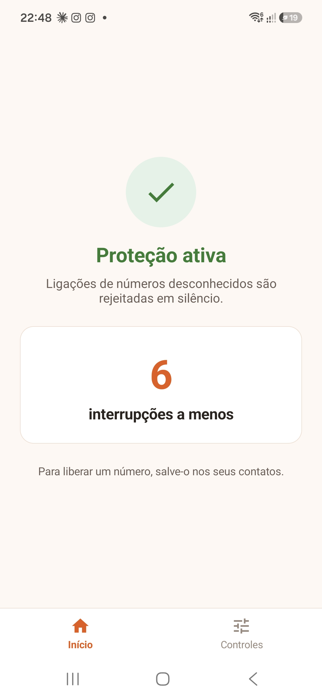
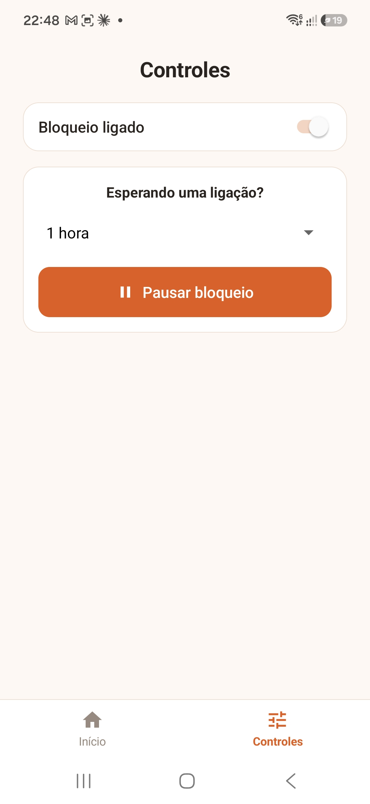
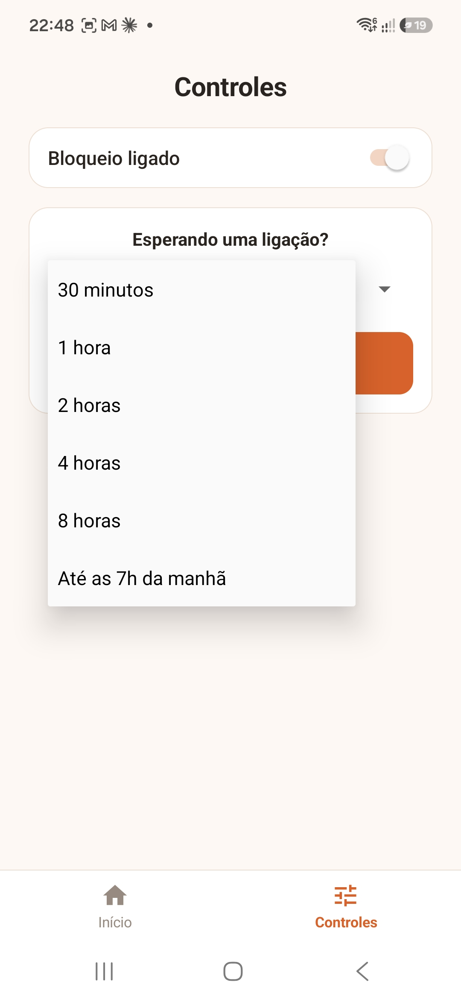

# Bloqueador

**Só toca quem é seu contato.**

Aplicativo gratuito para Android que rejeita em silêncio as ligações de números que não estão salvos nos seus contatos.

> Disponível em breve na Google Play.

## O que ele faz

- **Rejeita em silêncio** as ligações de números desconhecidos: não toca, não vibra e não aparece na tela.
- **Não interrompe** vídeo, jogo nem música.
- **Mantém no histórico** do app Telefone as ligações rejeitadas, para você ver depois.
- **Liga e desliga** o bloqueio com um interruptor.
- **Pausa por um tempo** (30 min a 8 h, ou até as 7h da manhã) quando você está esperando uma ligação, com contagem regressiva.
- **Conta as interrupções a menos**: quantas ligações indesejadas já foram filtradas.
- Para liberar um número, é só salvá-lo nos contatos.

## Privacidade

Tudo acontece no próprio aparelho. O app não tem permissão de internet, não usa anúncios e não coleta nem envia dados.
Leia a [política de privacidade](https://flavioclima.github.io/bloqueador/privacidade.html).

## Como funciona

O app usa o `CallScreeningService` do Android. Quando uma ligação chega, o sistema pergunta ao app se ela deve tocar. O app confere se o número está nos contatos e, se não estiver, rejeita a ligação antes de ela tocar.

## Capturas de tela

  

## Código-fonte

O código-fonte não é público.

## Contato

Dúvidas ou sugestões: abra uma [issue](../../issues) neste repositório.

---

Feito por [Flávio Correia Lima](https://github.com/flavioclima).
